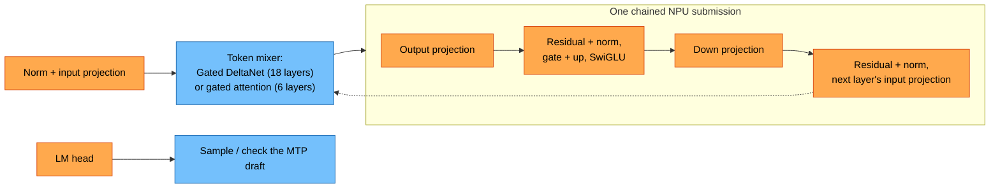
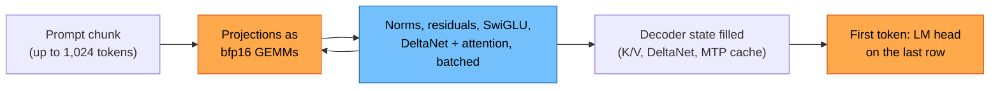

# Qwen3.5-2B

Fast side-task model and bring-up target for the shared Qwen3.5/3.6 kernels.
Dense hybrid: 24 layers (18 Gated DeltaNet + 6 gated full-attention, GQA 8/2,
head dim 256; DeltaNet 16 key / 16 value heads), hidden 2048, FFN 6144, vocab
248,320, tied embeddings, one MTP layer
([config](https://huggingface.co/Qwen/Qwen3.5-2B/blob/main/config.json)).
Est. ~1.1 GB of weights read per decoded token at ~4.5 bits per weight.

Weights: Unsloth `Qwen3.5-2B-MTP-GGUF`, UD-Q4_K_XL, revision
`e05864f8066d874d5f85aaff007ae57a2a7d1efe` (the BF16 file of the same
revision for the HF oracle tests). FastFlowLM's own pack is
`FastFlowLM/Qwen3.5-2B-NPU2` (`qwen3.5:2b`).

NPU decode with MTP speculation and NPU prefill: see
[benchmarks](BENCHMARKS.md) and [quality](QUALITY.md).

## How a token runs

Orange runs on the NPU, blue on the CPU.

**Decode, one layer** (1 or 2 tokens per pass):

*Qwen3.5-2B: 24 layers, hidden 2,048, FFN 6,144, GQA 8 query / 2 KV heads (head dim 256), DeltaNet 16 key / 16 value heads. Every weight matrix is a q4nx GEMV on the NPU; the CPU runs only the mixers (and DeltaNet's small alpha/beta rows), so a token is 25 NPU submissions (one per layer, plus one).*

**Prompt pass** (prompts of 7 tokens or more):

*With two chunks in flight, one chunk's GEMMs on the NPU overlap the CPU mixing the other.*
