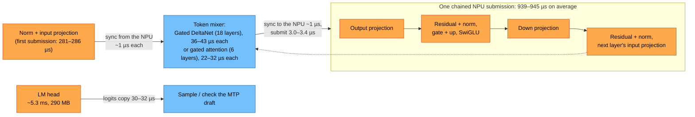
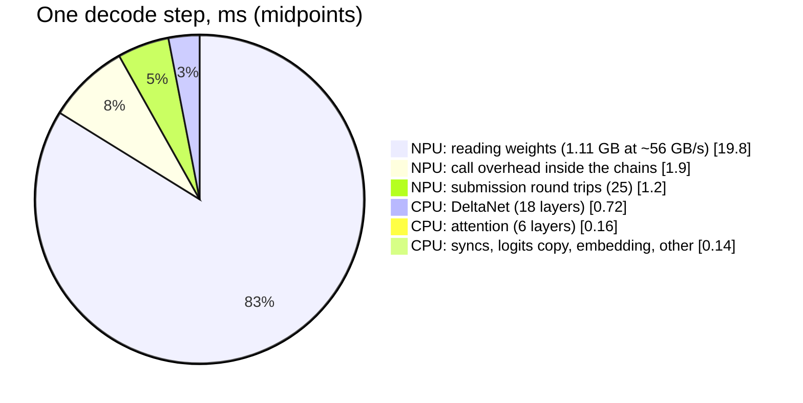
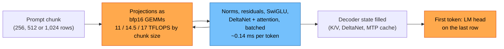

# Qwen3.5-2B

Fast side-task model and the family's bring-up target. Dense hybrid: 24 layers (18 Gated DeltaNet + 6 gated full-attention, GQA 8/2,
head dim 256; DeltaNet 16 key / 16 value heads), hidden 2048, FFN 6144, vocab
248,320, tied embeddings, one MTP layer
([config](https://huggingface.co/Qwen/Qwen3.5-2B/blob/main/config.json)).
Est. ~1.1 GB of weights read per decoded token at ~4.5 bits per weight.

It runs on its own NPU programs in its own package, `src/models/qwen35_2b/`:
the decode GEMV `qwen35_2b_decode` (`kernels/decode_gemv.py`, a copy of the
q4nx GEMV with only the 2B's shapes), the prefill GEMM `qwen35_2b_prefill`
(`kernels/prefill_gemm.py`, IRON's `flm.GEMM`), and the NPU decoder and
prefill wired to them. The CPU side (config, reference, `Decoder`/`Mixer`,
prefill mixers, tokenizer, chat template, MTP draft vocabulary) is the
Qwen3.5 family's shared code in `src/models/qwen35/`.

Weights: Unsloth `Qwen3.5-2B-MTP-GGUF`, UD-Q4_K_XL, revision
`e05864f8066d874d5f85aaff007ae57a2a7d1efe` (the BF16 file of the same
revision for the HF oracle tests). FastFlowLM's own pack is
`FastFlowLM/Qwen3.5-2B-NPU2` (`qwen3.5:2b`).

NPU decode with MTP speculation and NPU prefill: see
[benchmarks](BENCHMARKS.md) and [quality](QUALITY.md).

Image input (the vision tower, MRoPE and the plan to run it on the NPU):
[VISION.md](VISION.md).

## How a token runs

Orange runs on the NPU, blue on the CPU.

**Decode, one layer** (1 or 2 tokens per pass; times are one token without a draft, warm, from [BENCHMARKS.md](BENCHMARKS.md), "The host's part of a step"):

*Qwen3.5-2B: 24 layers, hidden 2,048, FFN 6,144, GQA 8 query / 2 KV heads (head dim 256), DeltaNet 16 key / 16 value heads. Every weight matrix is a q4nx GEMV on the NPU; the CPU runs only the mixers (and DeltaNet's small alpha/beta rows), so a token is 25 NPU submissions (one per layer, plus one). A layer's chain runs in ~683 µs inside a runlist, ~605 µs of it reading its 33.9 MB of weights; a submission adds the NPU's ~65 µs command round trip, and the last layer's also runs the LM head, which is why the average is 939–945 µs.*

**Where a decode step goes** (one token without a draft: 23.8–24.1 ms, ~42 tok/s):

*The NPU slices are estimates that add up to the measured 22.9 ms of submissions: weights read at the measured ceiling, the chains' measured ~683 µs against ~605 µs of reading, and the rest as round trips (`bench dispatch`: 65–70 µs for a one-run command). The CPU slices are measured. A two-token MTP verify step takes 26.1–26.4 ms: 24 layer submissions of 995–1,000 µs, DeltaNet 1.38–1.66 ms (each token makes its own passes over the state), attention 0.24–0.41 ms.*

**Prompt pass** (prompts of 7 tokens or more):

*With two chunks in flight, one chunk's GEMMs on the NPU overlap the CPU mixing the other. A pass costs ~0.10 s however short the prompt; time to first token is 0.18 s at 476 tokens, 0.31 s at 1,000, 0.58 s at 2,048 and 1.24 s at 4,096 ([BENCHMARKS.md](BENCHMARKS.md), "NPU prefill").*
