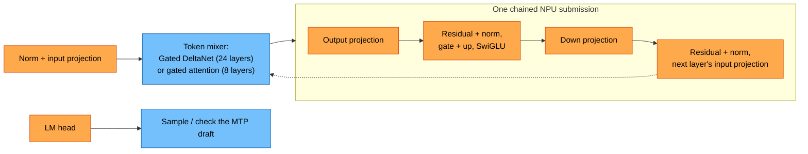
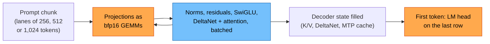

# Qwen3.5-4B

The 2B's bigger sibling: the same dense hybrid (Gated DeltaNet + gated full
attention every 4th layer, one MTP layer, tied embeddings), wider. It runs on
its own NPU programs in its own package, `src/models/qwen35_4b/`; the CPU
side (config, reference, `Decoder`/`Mixer`, tokenizer, chat template, MTP
draft vocabulary) is the Qwen3.5 family's shared code in `src/models/qwen35/`.
See [benchmarks](BENCHMARKS.md), [quality](QUALITY.md) and
[experiments](EXPERIMENTS.md).

## Weights

Unsloth [`unsloth/Qwen3.5-4B-MTP-GGUF`](https://huggingface.co/unsloth/Qwen3.5-4B-MTP-GGUF/tree/86835bf9949e4d14d6860f7910b1340ad4f271a9)
at revision `86835bf9949e4d14d6860f7910b1340ad4f271a9`,
`Qwen3.5-4B-UD-Q4_K_XL.gguf` (2,990,664,000 bytes, 441 tensors; imatrix
quant). Arch `qwen35`
([HF config](https://huggingface.co/Qwen/Qwen3.5-4B/blob/main/config.json)).

## Architecture (from the GGUF)

| | Qwen3.5-4B | Qwen3.5-2B |
|---|---|---|
| Decoder layers | 32 (24 DeltaNet, 8 attention: 3, 7, ..., 31) + MTP `blk.32` | 24 (18 + 6) + MTP |
| Hidden | **2560** | 2048 |
| FFN (SwiGLU) | **9216** | 6144 |
| Attention | 16 query heads over **4** KV heads, head dim 256; q carries a sigmoid gate per head; q/k RMS-normed; RoPE on 64 of 256 dims, base 1e7 (MRoPE sections [11, 11, 10, 0], plain RoPE for text) | 8 over 2 |
| Gated DeltaNet | 16 key heads, **32 value heads**, head dim 128 (key dim 2048, value dim 4096, conv 4 x 8192); value head h reads key head h % 16 | 16 / 16 |
| Vocab | 248,320, tied embeddings (`token_embd` is the LM head) | same |
| RMS eps | 1e-6 | same |
| Context | 262,144 | same |

The value-to-key head mapping is the 35B's (`Mixer::Linear`,
`NpuPrefill`); the 4B is the first dense model to use it, and the reference
matches llama.cpp layer by layer with it (QUALITY.md).

### Tensor types

| Tensors | Types |
|---|---|
| `token_embd` (LM head) | Q6_K |
| `attn_qkv` (DeltaNet in) | Q6_K x 10, Q4_K x 14 |
| `attn_gate` (DeltaNet z) | Q5_K |
| `ssm_out` | Q8_0 |
| `attn_q` / `attn_k` | Q4_K x 6, Q5_K x 2 |
| `attn_v` | Q6_K |
| `attn_output` | Q4_K |
| `ffn_gate` / `ffn_up` | Q4_K x 27, Q5_K x 5 |
| `ffn_down` | Q6_K x 15, Q4_K x 12, Q5_K x 5 |
| MTP: `eh_proj` | Q8_0; the block Q4_K (attn_v Q6_K) |
| norms, `ssm_a`, `ssm_dt`, `ssm_alpha/beta`, conv | F32 |

By bytes: Q4_K 1.23 GB, Q6_K 1.00 GB, Q5_K 0.45 GB, Q8_0 0.28 GB. The NPU
path packs every matrix into q4nx (4.625 bits per weight): Q4_K code for code,
the rest requantized.

## How a token runs

Orange runs on the NPU, blue on the CPU.

**Decode, one layer** (1 or 2 tokens per pass):

*Qwen3.5-4B: 32 layers, hidden 2,560, FFN 9,216, GQA 16 query / 4 KV heads (head dim 256), DeltaNet 16 key / 32 value heads; its own NPU programs (`qwen35_4b_decode`, `qwen35_4b_prefill`). Every weight matrix is a q4nx GEMV on the NPU; the CPU runs only the mixers (and DeltaNet's small alpha/beta rows), so a token is about 33 NPU submissions (33.5 measured).*

**Prompt pass** (prompts of 7 tokens or more):

*With two chunks in flight, one chunk's GEMMs on the NPU overlap the CPU mixing the other.*

## Bytes per decoded token (q4nx)

| Part | Rows x dim | MB per token |
|---|---|---|
| DeltaNet input (qkv + z), 24 layers | 12,288 x 2,560 | 24 x 18.2 |
| Attention input (q + gate, k, v), 8 layers | 10,240 x 2,560 | 8 x 15.2 |
| Mixer output, 32 layers | 2,560 x 4,096 | 32 x 6.1 |
| FFN gate + up, 32 layers | 18,432 x 2,560 | 32 x 27.3 |
| FFN down, 32 layers | 2,560 x 9,216 | 32 x 13.6 |
| LM head | 248,320 x 2,560 | 368 |
| **Total** | | **~2.42 GB** (2B: ~1.09 GB) |

At the NPU's ~56 GB/s read ceiling that is ~43 ms, ~23 tok/s without
speculation.

## Code

- `src/models/qwen35_4b/kernels/`: `decode_gemv.py` + `aie/decode_gemv.cc`
  (the decode GEMV, copied from the 2B's with the 4B's geometry, xclbin
  `qwen35_4b_decode`) and `prefill_gemm.py` (the prefill GEMM, xclbin
  `qwen35_4b_prefill`), each with its pure-data `*_variants.py`, registered
  with `gufo_npu_add_kernel(... MODEL qwen35_4b)`.
- `src/models/qwen35_4b/npu/gemv.hpp`: the host's copy of the geometry.
- `src/models/qwen35_4b/npu_decoder.*`, `npu_prefill.*`: the 2B's host
  wiring with the 4B's constants and programs.
- `tests/models/qwen35_4b/`: labels `qwen35_4b` plus `model`, `npu`,
  `kernels`. Variables: `GUFO_NPU_QWEN35_4B_GGUF` (the GGUF above),
  `GUFO_NPU_QWEN35_4B_ORACLE` (output of
  `tools/reference/qwen36_llama_oracle.py --model <gguf> --out <dir>`).
