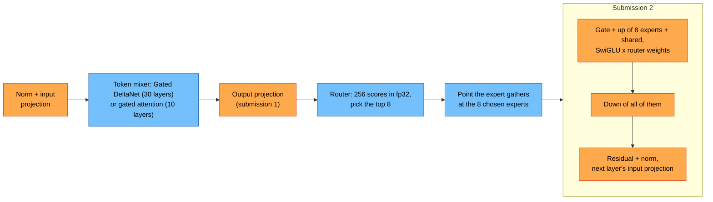
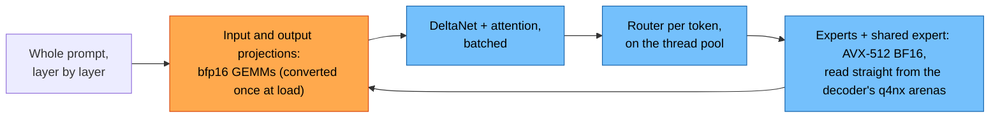

# Qwen3.6-35B-A3B

Hybrid MoE: 40 layers (30 Gated DeltaNet + 10 gated full-attention, GQA 16/2,
head dim 256), 256 experts with 8 active plus 1 shared expert (FFN 512),
hidden 2048, vocab 248,320, one MTP layer. About 3 B active parameters per
token, ~1.7 GB of weights read per decoded token at ~4.5 bits per weight.

Weights, in order of support:
1. FastFlowLM's Q4NX pack (`qwen3.6-moe:35b-a3b`), which is already laid out
   for the NPU.
2. Unsloth UD GGUF (arch `qwen35moe`), repacked for the NPU (also carries the
   MTP head).

State: the fp32 CPU reference (`src/models/qwen35/reference.cpp`, shared with
Qwen3.5-2B) runs this model from the GGUF and is checked against llama.cpp
([QUALITY.md](QUALITY.md)). `generate --device npu` decodes it on the NPU
(`NpuDecoder`): every matrix in q4nx (4.625 bits per weight) on the NPU,
each layer's experts in one device arena read through two gathers, the
mixers and the router on the CPU. The MTP layer drafts on the NPU and a
two-token pass verifies (same output as plain greedy). Prompts of 6 tokens
or more go through `NpuPrefill` (src/models/qwen36_35b_a3b) layer by layer:
the dense matrices as bfp16 GEMMs on the NPU, the experts on the CPU
straight from the decoder's q4nx arenas (1.25 s to the first token at ~1k
tokens). Speeds in [BENCHMARKS.md](BENCHMARKS.md). See
[the plan](../../PLAN.md).

## How a token runs

Orange runs on the NPU, blue on the CPU.

**Decode, one layer** (1 or 2 tokens per pass):

*Qwen3.6-35B-A3B: 40 layers, hidden 2,048, GQA 16 query / 2 KV heads (head dim 256), DeltaNet 16 key / 32 value heads, 256 experts (FFN 512) with 8 active plus 1 shared. Each layer's experts sit in one device arena; the host rewrites the gathers' read offsets in the instruction stream after routing, so only the chosen experts are read. Two submissions per layer, 81 per token; a 2-token pass reads the union of both tokens' experts once.*

**Prompt pass** (prompts of 6 tokens or more, up to 16,384 tokens per pass):

*The experts run on the CPU because it reads memory about twice as fast as the NPU and a prompt touches all 256 experts per layer; this beats the NPU expert kernels at every prompt length. About half the prompt pass's FLOPs run on the NPU (51% at ~1k tokens).*

## The GGUF (`Qwen3.6-35B-A3B-UD-Q4_K_XL.gguf`)

Unsloth's `Qwen3.6-35B-A3B-MTP-GGUF`, UD-Q4_K_XL: 22.85 GB, 753 tensors,
35.5 B parameters, arch `qwen35moe`. `tools/gguf/inspect_gguf.py <file>
--tensors` lists it.

| Key | Value |
|---|---|
| `block_count`, `nextn_predict_layers` | 41, 1: decoder layers 0–39, MTP layer `blk.40` |
| `full_attention_interval` | 4: layers 3, 7, …, 39 are full attention (10), the rest Gated DeltaNet (30) |
| `embedding_length` | 2048 |
| `attention.head_count`, `head_count_kv` | 16, 2 (8 query heads per KV head) |
| `attention.key_length`, `value_length` | 256, 256 |
| `rope.dimension_count`, `freq_base` | 64, 1e7 |
| `rope.dimension_sections` | [11, 11, 10, 0] (interleaved MRoPE; text uses one position, so plain RoPE) |
| `attention.layer_norm_rms_epsilon` | 1e-6 |
| `ssm.group_count` (key heads) | 16 |
| `ssm.time_step_rank` (value heads) | 32 |
| `ssm.state_size` (head dim) | 128: key dim 2048, value dim 4096, conv channels 8192 |
| `ssm.conv_kernel`, `ssm.inner_size` | 4, 4096 |
| `expert_count`, `expert_used_count` | 256, 8 |
| `expert_feed_forward_length` | 512 |
| `expert_shared_feed_forward_length` | 512 |
| `context_length` | 262,144 |
| vocab | 248,320 (`token_embd`); `output.weight` is a separate, untied LM head |

There is no `feed_forward_length`, `expert_gating_func`,
`expert_weights_norm` or `expert_weights_scale` key: llama.cpp hard-codes the
routing for this arch (below).

### Tensor types

| Type | Tensors |
|---|---|
| Q8_0 | `token_embd`, `output`, every attention and DeltaNet projection (`attn_q/k/v/output`, `attn_qkv`, `attn_gate`, `ssm_out`), the shared expert (`ffn_*_shexp`), `nextn.eh_proj` |
| Q4_K | routed `ffn_gate_exps` and `ffn_up_exps`, layers 0–38 and 40 |
| Q5_K | routed `ffn_down_exps` (all but 3 layers); `ffn_gate_exps`, `ffn_up_exps` of layer 39 |
| Q6_K | routed `ffn_down_exps` of layers 34, 38, 39 |
| F32 | norms, router `ffn_gate_inp` [2048, 256], shared-expert gate `ffn_gate_inp_shexp` [2048], `ssm_alpha`/`ssm_beta` [2048, 32], `ssm_conv1d` [4, 8192], `ssm_a`, `ssm_dt.bias`, `ssm_norm` [128] |
| BF16 | the MTP layer's `ffn_gate_inp` and `ffn_gate_inp_shexp` |

No IQ or MXFP4 types, so `src/core/quant.cpp` already dequantizes all of it.
Routed experts are stacked as `[cols, rows, 256]`: expert e of
`ffn_gate_exps`/`ffn_up_exps` ([2048, 512, 256]) is rows `[512 e, 512 e + 512)`,
of `ffn_down_exps` ([512, 2048, 256]) rows `[2048 e, 2048 e + 2048)`.

Read per decoded token as stored (no MTP, one embedding row): 2.75 GB, of
which DeltaNet projections 1.09 GB (Q8_0), 8 routed experts × 40 layers
0.61 GB, LM head 0.54 GB (Q8_0), attention 0.29 GB, shared experts 0.13 GB,
routers 0.08 GB (F32); 2.95 B parameters. The 4-bit figure above assumes the
Q8_0 tensors are requantized too.

## Forward pass

As Qwen3.5 ([REFERENCE.md](../qwen3.5-2b/REFERENCE.md)), with these sizes and:

- **DeltaNet value heads ≠ key heads.** 32 value heads over 16 key heads:
  value head h uses key head `h % 16` (the GGUF stores V-side tensors in
  tiled order; llama.cpp `ggml_repeat`s q and k). Checked against llama.cpp
  to float precision ([QUALITY.md](QUALITY.md)).
- **MoE FFN** on `x = RMS(h) * post_attention_norm`:
  1. `logits = ffn_gate_inp · x` (256), `p = softmax(logits)` over all 256.
  2. Top 8 by p (ties to the lower index), weights `w_i = p_i / Σ_top8 p`
     (`norm_topk_prob`; llama.cpp clamps the sum to ≥ 6.1e-5 first). No
     expert bias, groups or extra scale.
  3. Each chosen expert: `down_e(silu(gate_e x) ⊙ up_e x)` (SwiGLU, width 512).
  4. Shared expert: `s = down_sh(silu(gate_sh x) ⊙ up_sh x)`, scaled by the
     scalar `sigmoid(ffn_gate_inp_shexp · x)`.
  5. `ffn(x) = Σ_i w_i expert_i(x) + sigmoid(g · x) s`, added to the residual.
- **Untied LM head**: `logits = output · (RMS(h) * output_norm)`.

Same semantics in gufo (`src/models/qwen/modules/moe.cpp`) and llama.cpp
(`src/models/qwen35moe.cpp`, `build_moe_ffn` with softmax gating and
`norm_w = true`).

## MTP layer (`blk.40`)

A full-attention block with the same MoE FFN (256 experts; BF16 router and
shared gate) plus `nextn.eh_proj` [4096, 2048], `nextn.enorm`, `nextn.hnorm`
and `nextn.shared_head_norm`. It has no embedding or head of its own:
llama.cpp uses `token_embd` and `output`. As on the 2B,
`x = eh_proj · [RMS(embed(token)) * enorm ; RMS(h) * hnorm]` with h the main
model's last hidden state after `output_norm` (llama.cpp's `t_h_nextn`), then
the block, then `output · (RMS(x) * shared_head_norm)`. `Reference::Mtp`
implements it. The block attends only to its own K/V cache, and RoPE scores
depend only on position differences, so where its positions start does not
matter as long as each draft step advances by one.
